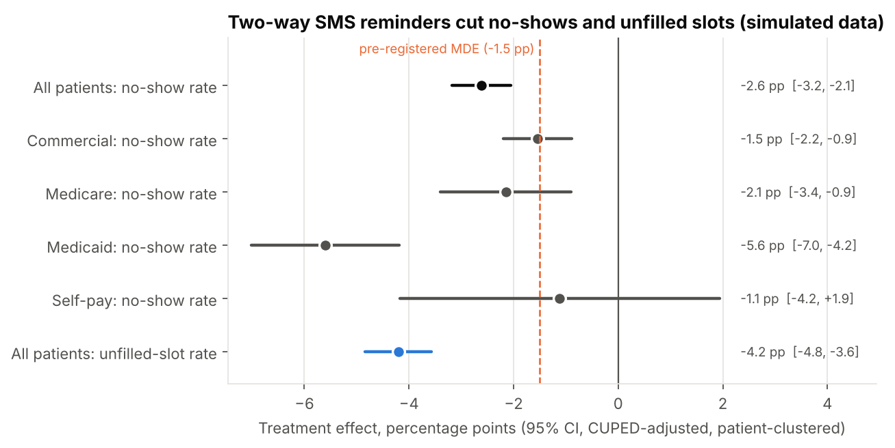
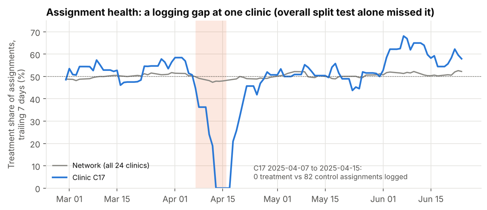
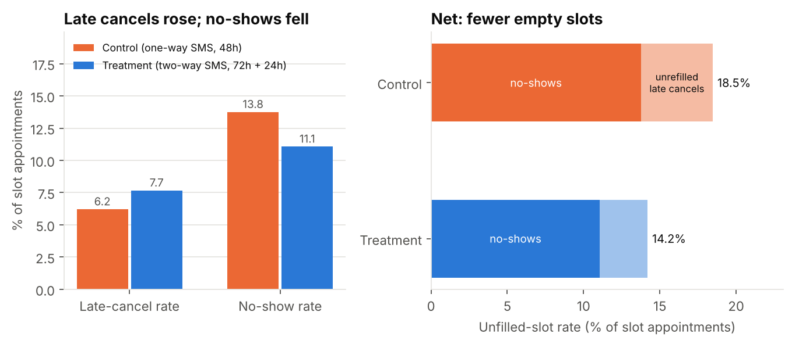
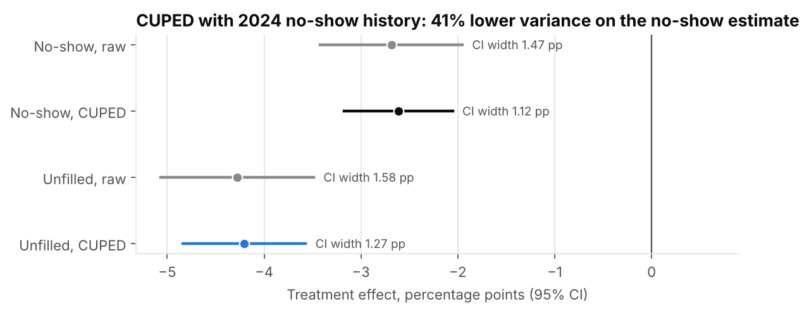
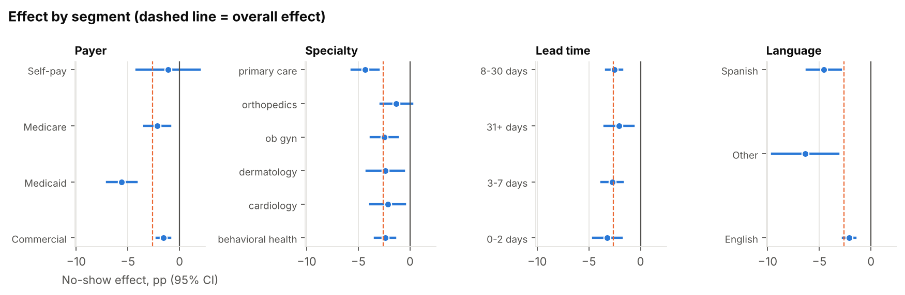
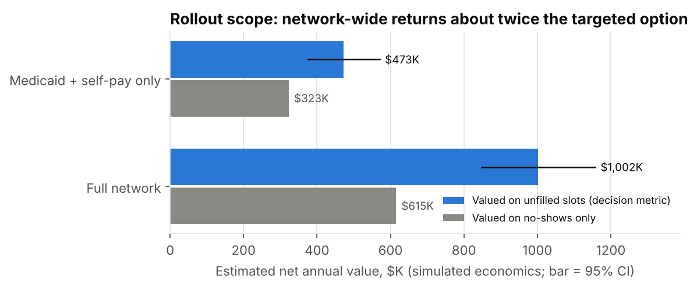
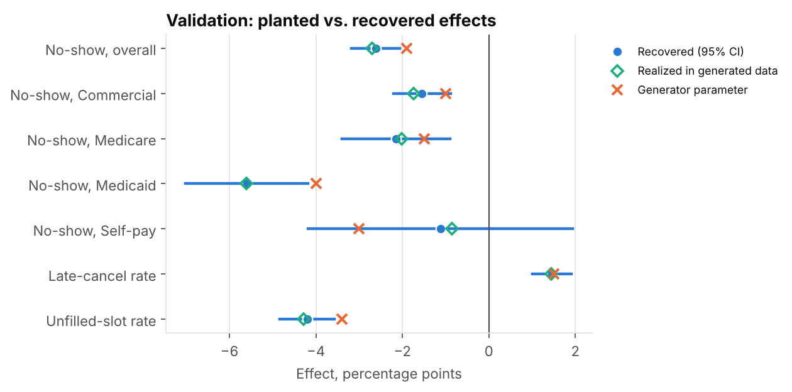

# Appointment Reminder A/B Test: No-Shows and Unfilled Slots

**Business question:** Does a two-way SMS reminder with one-tap rescheduling reduce outpatient no-shows and unfilled slots enough to justify rolling it out, and for which patients?

> **Synthetic data notice.** All data in this repository is synthetic, generated by `src/generate_data.py` (seed 42). No real patients, members, customers, or organizations. Findings describe the simulated system, not any real clinic network.



## TL;DR

- **No-shows fell 2.62 pp** (13.8% to 11.1%, 95% CI -3.18 to -2.05 pp, a 19% relative reduction), CUPED-adjusted with patient-clustered errors.
- **Late cancels rose 1.46 pp, but unfilled slots fell 4.20 pp** (18.5% to 14.2%). Two-way texts free slots early enough to refill them: the refill rate of late-cancelled slots went from 24% to 59%. A reading of "cancellations went up" alone would have stopped a feature that works.
- **The overall sample-ratio test passed (p = 0.55) but missed a broken experiment cell.** A clinic-by-week scan found clinic C17 logged 0 treatment vs. 82 control assignments from 2025-04-07 to 2025-04-15. Those patients were excluded from both arms.
- **Decision under the pre-registered rule: roll out network-wide.** Estimated net value is $1,002K per year (95% CI $848K to $1,157K) versus $473K for a Medicaid + self-pay-only rollout, in the simulated economics.

## Business context (simulated)

The Director of Ambulatory Access at a simulated 24-clinic outpatient network has to choose: roll out two-way reminders network-wide, roll out to targeted payer segments, or stop. Control patients get today's one-way SMS 48 hours before the visit. Treatment patients get a two-way SMS at 72 hours and 24 hours with a one-tap reschedule link. Randomization is 50/50 at the patient level, 2025-03-03 to 2025-06-29 (17 weeks). Calendar 2024 is the pre-period.

The design, metrics, power analysis, and decision rule were written down before the results: [docs/experiment_design.md](docs/experiment_design.md).

## Skills demonstrated

- Experiment design: power and sample size with a design effect for clustered outcomes, a pre-registered decision rule
- Sample-ratio-mismatch (SRM) checks: an overall chi-square test, then a clinic-by-week binomial scan with Benjamini-Hochberg correction, and a cross-check against the message log
- Metric design: the no-show rate compared with the unfilled-slot rate, with late cancels as a guardrail
- Inference: difference in proportions with patient-clustered (cluster-robust) standard errors, CUPED variance reduction, interaction models with BH correction
- SQL (DuckDB, written to port to PostgreSQL): window functions (`ROW_NUMBER`, `COUNT ... OVER`), CTEs, time-zone conversion with `AT TIME ZONE`, anti-joins
- Cost/benefit sizing with confidence intervals for each rollout scope
- Data cleaning of planted issues: status-code drift, mis-coded reschedules, duplicate assignments, UTC vs. local time
- Communication: an executive summary, a self-contained dashboard, and a Power BI star-schema export

## Approach

1. **Generate** six related tables (420,134 appointments, 31,233 assignment rows, 300,313 SMS messages) with planted effects and data-quality issues: [`src/generate_data.py`](src/generate_data.py).
2. **Load** the CSVs into DuckDB: [`src/load.py`](src/load.py).
3. **Stage and clean** in SQL: [`sql/01_staging/`](sql/01_staging/). This step normalizes status codes, re-labels mis-coded reschedules, de-duplicates assignments (first assignment wins), and converts UTC message times to clinic-local time.
4. **Model marts**: [`sql/02_marts/`](sql/02_marts/). This step builds the appointment outcome fact with metric flags, the 2024 patient no-show history, and the experiment analysis table.
5. **Answer the questions**, one SQL file each: [`sql/03_analysis/`](sql/03_analysis/) (SRM, primary metric, guardrails, CUPED inputs, segments, rollout sizing).
6. **Statistics** in Python: [`src/analysis.py`](src/analysis.py) (SRM detection and exclusion, clustered CIs, CUPED, interactions with BH, value CIs, power). Results go to `reports/results.json`.
7. **Charts, dashboard, and documents**: [`src/figures.py`](src/figures.py), [`src/dashboard.py`](src/dashboard.py) produces [`dashboard/index.html`](dashboard/index.html), and [`src/report.py`](src/report.py) fills this README from `results.json`.

## Key findings

### 1. Assignment logging failed in one cell, and the overall test did not catch it



The overall split was 15,456 control vs. 15,560 treatment (50.17% treatment, chi-square p = 0.55). That passes. The gap was too small to move the network total: at this sample size, an overall test at p < 0.001 needs about 580 missing treatment patients. The clinic-by-week scan (432 cells, binomial test per cell, BH q < 0.01) flagged 1 cell at clinic C17. A day-level look narrowed the gap to 2025-04-07 to 2025-04-15: 0 treatment vs. 82 control (p = 4e-25). The message log confirmed the cause. 81 patients at C17 received two-way texts, which only treatment patients get, but had no assignment row. That means a logging outage, not a randomization failure.

Fix: exclude every patient assigned at C17 in that window, in both arms. After the exclusion the split is 50.30% treatment (p = 0.29).

### 2. The no-show rate understates the value; the unfilled-slot rate is the decision metric



| Metric (slot appointments) | Control | Treatment | Effect (pp) | 95% CI (pp) |
|---|---|---|---|---|
| No-show rate (primary) | 13.8% | 11.1% | -2.62 | -3.18 to -2.05 |
| Late-cancel rate (guardrail) | 6.2% | 7.7% | +1.46 | +1.01 to +1.91 |
| Refill rate of late-cancelled slots | 24% | 59% | +35.1 | +32.1 to +38.2 |
| Unfilled-slot rate (decision metric) | 18.5% | 14.2% | -4.20 | -4.84 to -3.57 |

No-show, unfilled-slot, and late-cancel effects are CUPED-adjusted; the refill row is unadjusted. Late cancels went up 24% in relative terms, which looks like a failed guardrail. But a cancellation 24 to 72 hours out can be refilled from the waitlist, and a no-show cannot. Unfilled slots fell 4.20 pp, a larger drop than the no-show rate alone shows (2.62 pp).

### 3. CUPED cut variance by 41%



The covariate is each patient's 2024 no-show rate. At the patient level it correlates with the experiment-period no-show rate at rho = 0.56 (n = 25,019 patients with 2024 history). The adjustment shrank the no-show CI from -3.42 to -1.95 pp (raw) to -3.18 to -2.05 pp. Getting the same precision without CUPED would take about 71% more patients. The point estimate barely moved (-2.69 raw vs. -2.62 adjusted) because 2024 no-show rates were already close across arms (13.6% vs. 13.7%).

### 4. The effect is largest for Medicaid; language differences mostly track payer



| Payer | Control no-show | Effect (pp) | 95% CI (pp) |
|---|---|---|---|
| Commercial | 9.2% | -1.5 | -2.2 to -0.9 |
| Medicare | 12.2% | -2.1 | -3.4 to -0.9 |
| Medicaid | 23.0% | -5.6 | -7.0 to -4.2 |
| Self-pay | 21.8% | -1.1 | -4.2 to +1.9 |

The models tested 13 interaction terms (payer, specialty, lead-time band, language), and 4 pass BH at q < 0.10. The Medicaid interaction is -4.0 pp vs. commercial (q = 6e-06). Spanish-language patients show -2.4 pp (q = 0.04), but this falls to -1.4 pp (p = 0.13) once the payer interaction is in the model, because Spanish speakers are more often Medicaid in this population. The self-pay CI is wide because self-pay is 5% of patients.

### 5. A network-wide rollout is worth about twice a targeted one



| Scope | Slots recovered / yr | Annual cost | Net value / yr (95% CI) |
|---|---|---|---|
| Full network | 6,412 | $24K | $1,002K ($848K to $1,157K) |
| Medicaid + self-pay only | 3,076 | $20K | $473K ($375K to $570K) |

Simulated economics: $0.04 per message, $18,000 per year platform fee, $160 contribution margin per filled slot. Annual volume uses 2024 slot appointments for SMS-opted-in patients (152,505). The refill gain applies to every payer, so per-appointment value is positive in all segments. The fixed platform fee is small. The break-even effect is 0.10 pp of unfilled slots. Valued on no-shows alone, the full rollout would be worth $615K.

## Recommendations

1. **Decision: roll out network-wide** (Findings 2 and 5). This is the pre-registered rule's outcome: the unfilled-slot CI is entirely below zero, and the lower bound of net value is positive. The full rollout adds about $530K per year over the targeted option.
2. **Report unfilled-slot rate, not only no-show rate, on the access scorecard** (Finding 2). Keep late-cancel rate as a guardrail, read together with the refill rate. A rising late-cancel rate with a falling unfilled rate is the intended behavior.
3. **Add a per-clinic daily SRM monitor to the experiment platform and alert on the message-log cross-check** (Finding 1). The overall split test cannot see a gap this small. Medicaid patients get the largest benefit, so prioritize their waitlist-refill workflows (Finding 4).

## Validation: planted vs. recovered

The generator writes its parameters and the realized values to [`data/truth/planted_effects.json`](data/truth/planted_effects.json). "Realized" is computed from the generator's clean data (all truly assigned patients, before the data-quality issues were planted). Recovered estimates come from the cleaned pipeline with SRM exclusions applied. `tests/test_validation.py` asserts these checks.



| Effect | Generator parameter | Realized in generated data | Recovered (95% CI) | Realized inside CI? |
|---|---|---|---|---|
| No-show effect, all payers (pp) | -1.90 | -2.70 | -2.62 (-3.18 to -2.05) | yes |
| No-show effect, Commercial (pp) | -1.00 | -1.74 | -1.55 (-2.20 to -0.89) | yes |
| No-show effect, Medicare (pp) | -1.50 | -2.02 | -2.15 (-3.40 to -0.90) | yes |
| No-show effect, Medicaid (pp) | -4.00 | -5.61 | -5.60 (-7.02 to -4.18) | yes |
| No-show effect, Self-pay (pp) | -3.00 | -0.85 | -1.12 (-4.18 to +1.94) | yes |
| Late-cancel effect (pp) | +1.50 | +1.45 | +1.46 (+1.01 to +1.91) | yes |
| Refill of late cancels, treatment minus control (pp) | +35.0 | +35.1 | +35.1 (+32.1 to +38.2) | yes |
| Unfilled-slot effect (pp) | -3.40 | -4.29 | -4.20 (-4.84 to -3.57) | yes |
| Pre/post patient no-show correlation (rho) | about 0.55 | 0.558 | 0.557 | yes |
| SRM logging gap: clinic and dates | C17, 2025-04-07 to 2025-04-15 | 93 treatment rows dropped | C17, 2025-04-07 to 2025-04-15 (81 unlogged patients found via message log) | yes |
| Patients with conflicting duplicate assignments | 0.7% of patients | 217 | 217 | yes |
| Rescheduled originals mis-coded as no-show | 60% of reschedules | 2,740 | 2,691 corrected | partial: originals whose new booking fell after 2025-12-31 have no link |

Why the realized no-show effect (-2.70 pp) differs from the parameter (-1.90 pp): each patient has a latent no-show propensity drawn from a Beta distribution (needed for rho of about 0.55). With about 15,000 patients per arm, chance differences in who lands in each arm, plus binomial noise, move the realized difference by several tenths of a point. The expected effect given the patients actually drawn is -1.92 pp. The analysis recovers what is in the data. For the planted parameter itself, coverage at 95% is expected but not guaranteed for any one seed.

## Data-quality issues found and how they were handled

| Issue (planted) | Found | Handling |
|---|---|---|
| Status codes in 15 spellings ('NOSHOW', 'No Show', 'NS', 'CANCELED', ...) | 420,134 appointments | Mapped to 5 canonical codes in `02_stg_appointment.sql` |
| Rescheduled originals closed out as no-shows | 2,691 | Re-labelled 'rescheduled' when a later appointment points to them; excluded from the slot universe |
| Duplicate assignment rows with conflicting variants | 217 patients | First assignment by time wins (pre-registered); `03_stg_assignment.sql` |
| `sent_at` in UTC, `scheduled_at` clinic-local (3 Central clinics) | median one-way reminder lead: 42.9 h naive vs. 48.0 h corrected (Central); 43.9 h naive (Eastern) | Converted with `AT TIME ZONE` per clinic in `04_stg_message.sql` |
| NULL `delivery_status` | 5,992 messages (2.0%) | Reported as 'unknown', not counted as delivered |
| `booked_at` later than `scheduled_at` | 2,154 appointments | Kept for outcomes; lead time set to NULL and excluded from the lead-time segment |
| Logging outage dropped treatment assignments | 81 patients at C17 | Detected by SRM scan; patients assigned at that clinic in that window excluded from both arms |

## How to reproduce

```bash
pip install -r requirements.txt
make all      # generate -> load -> clean -> analyze -> figures -> dashboard -> report (about 1 minute)
pytest -q
```

No network access is needed. Outputs: `reports/results.json`, `figures/`, `dashboard/index.html`, `powerbi/`.

## Limitations and next steps

- The data is synthetic. Effect sizes, costs, and margins are simulated assumptions, not benchmarks.
- Statuses are generated without day-of-week or seasonal no-show patterns. The design is randomized, so this does not bias the comparison, but it makes the data look simpler than real data.
- The value model assumes every recovered slot earns the full $160 margin. If demand is limited, some refilled slots would have been booked later anyway, so the value is an upper bound. A follow-up should measure waitlist depth by clinic.
- The power analysis assumed 2.6 appointments per patient and ICC 0.15. Realized values were 1.68 slot appointments per patient and a design effect of 1.29 (implied ICC 0.42). Achieved power at the 1.5 pp MDE was 99%.
- Patient-level randomization means that, within a clinic, both arms share the same waitlist. A cluster-randomized rollout by clinic would test the refill mechanism at scale.
- Next: a holdout after rollout, and a test of the 72-hour timing alone vs. the reschedule link alone.

## Repo map

```
README.md                      this file (generated by src/report.py from docs/templates/)
Makefile                       make all = generate -> load -> clean -> analyze -> figures -> dashboard -> report
src/generate_data.py           synthetic data generator (seed 42) + truth file
src/load.py                    CSV -> DuckDB raw tables; runs staging and marts SQL
src/analysis.py                SRM, clustered CIs, CUPED, segments + BH, sizing, power -> reports/results.json
src/figures.py                 PNG charts -> figures/
src/dashboard.py               self-contained Plotly dashboard -> dashboard/index.html
src/report.py                  fills README and executive summary from results.json
src/export_powerbi.py          star-schema CSVs for Power BI -> powerbi/
sql/01_staging/                cleaning and standardization
sql/02_marts/                  outcome fact, pre-period history, experiment table, message rollup
sql/03_analysis/               one file per business question
tests/                         data quality, validation vs. truth, report consistency
docs/experiment_design.md      pre-registered design (written before results)
docs/data_dictionary.md        tables, columns, time zones, planted issues
docs/methodology.md            methods, assumptions, limitations
docs/executive_summary.md      one page for the director
data/sample/                   up to 1,000 rows per raw table (full data is generated, not committed)
data/truth/planted_effects.json generator parameters and realized values
```

## About

Built by Adedeji M. Olugboja — linkedin.com/in/adedeji-olugboja

License: MIT
